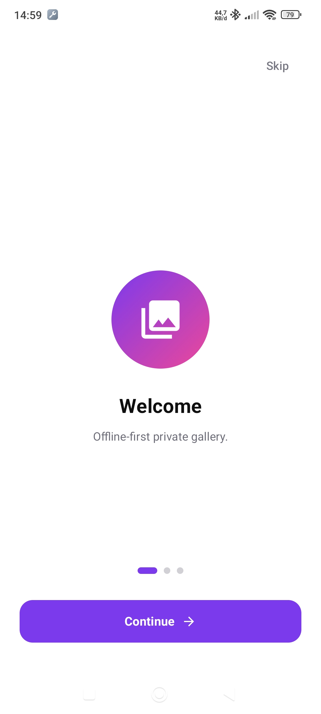
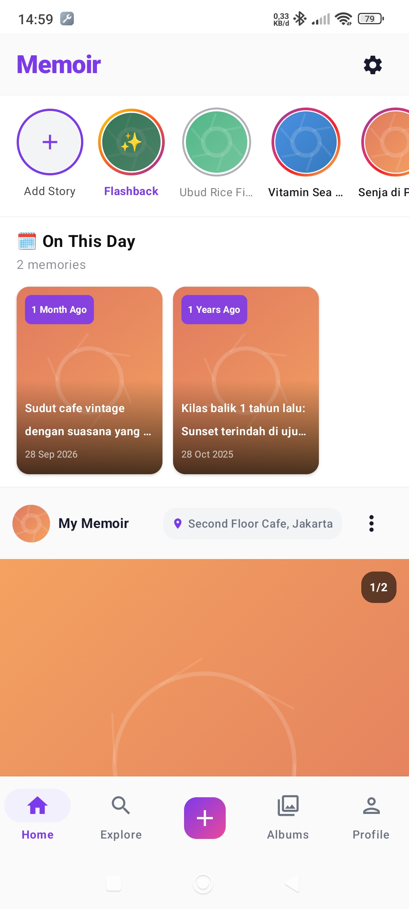
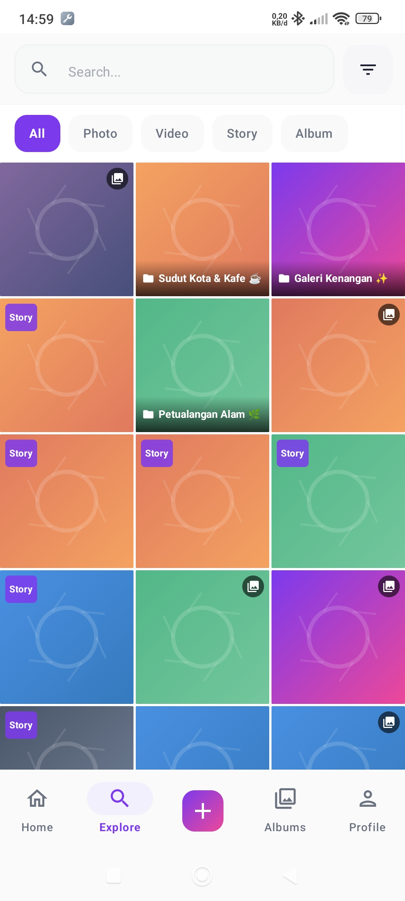
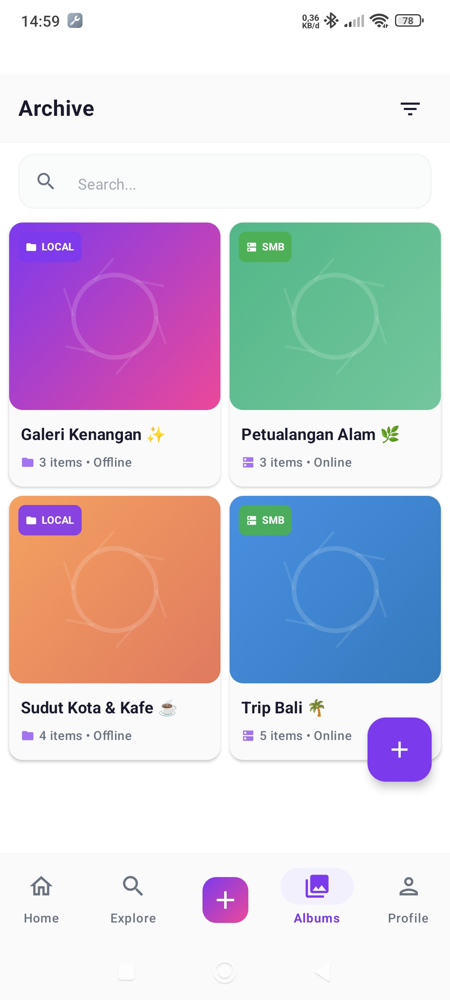
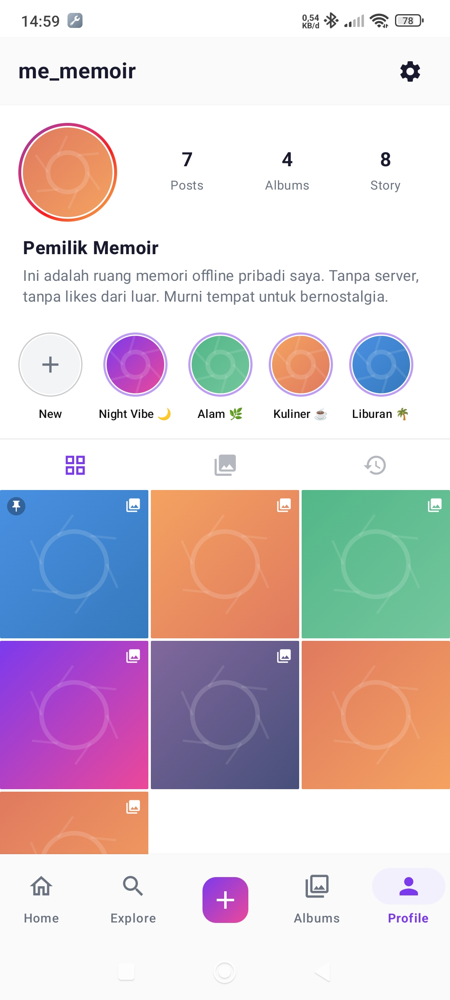
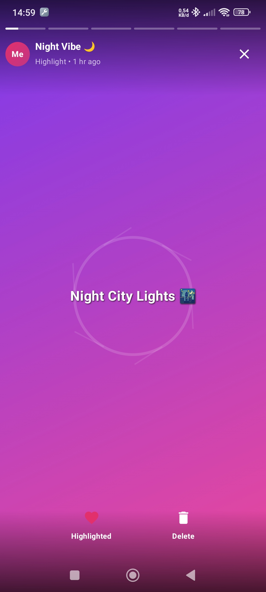
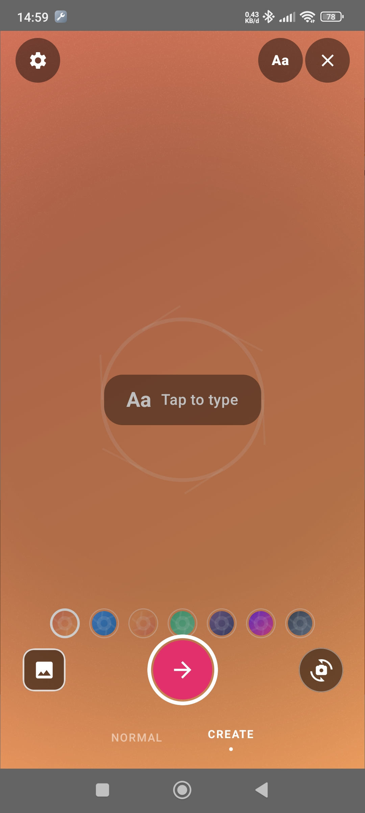
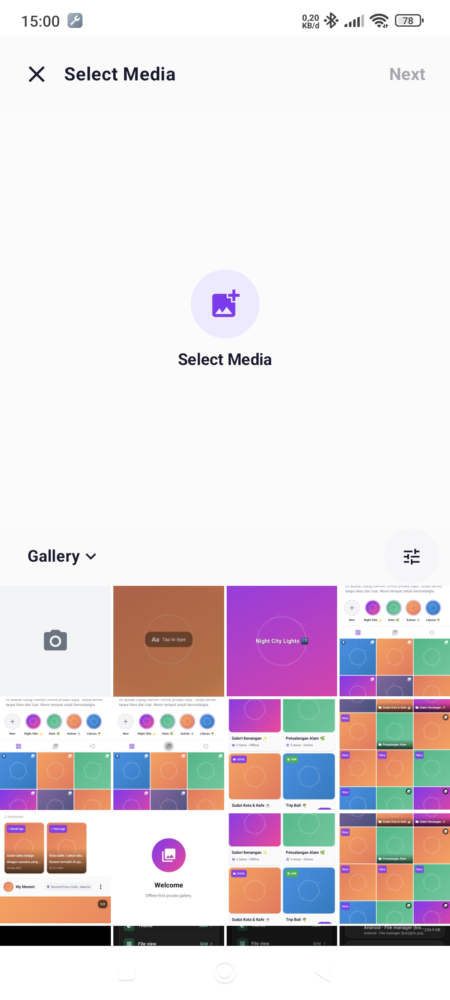
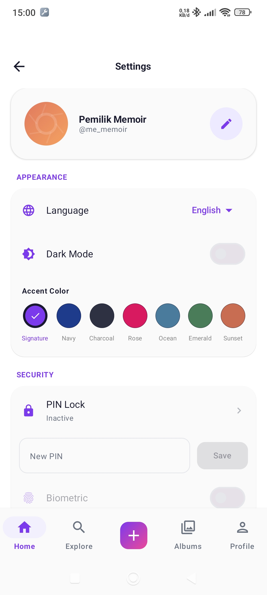

# Memoir

[](https://github.com/okkysatria/Memoir/releases/download/v1.0/Memoir.apk)

Memoir is an Android app for keeping a personal visual journal. Create posts, stories, and albums from photos and videos, then browse memories stored on the device or on an SMB share. Journal data is managed locally, with folder and SMB backup options. The app does not provide an online social network or a cloud sign-in/sync flow; some cloud connection options visible in the UI are not implemented yet.

## Screenshots

| Onboarding | Home | Explore |
|---|---|---|
|  |  |  |

| Albums | Profile | Story viewer |
|---|---|---|
|  |  |  |

| Story creator | Media picker | Settings |
|---|---|---|
|  |  |  |

## Features

### Posts and memories

- Create posts with photos or videos, captions, locations, and multiple media items.
- Edit or delete posts; like, save, pin, or lock them.
- Add comments and tags to posts.
- Browse memories from the same date in previous years.

### Stories and highlights

- Create photo or video stories with captions and text styling.
- View stories, track watched stories, and browse active stories in the story tray.
- Stories expire after 24 hours; keep selected stories in profile highlights.

### Albums and discovery

- Create albums and add or remove media items.
- Search posts and filter or sort content by type, date, and album source.
- Browse photos and videos in the Explore screen.

### SMB and backup

- Save SMB/NAS connections, test access, and browse available shares.
- Sync media from SMB sources and import or export journal files.
- Import and export the `memoir_data` folder through Android's system folder picker.
- A periodic background worker checks configured SMB connections for new media.

### Privacy, preferences, and widget

- Protect the app with a PIN or biometric unlock.
- Choose the app theme and language, and manage cached files.
- Add the “Memories Today” widget to the Android home screen. Its Indonesian display name is “Kenangan Hari Ini”.

## Project structure

```text
app/src/main/java/com/example/
├── MainActivity.kt                 Activity and app entry point
├── data/
│   ├── backup/                     Backup data models
│   ├── database/                   Room entities, DAO, converters, and database
│   └── repository/                 Journal, backup, and preference repositories
├── glance/                         Home screen widget (Glance)
├── ui/
│   ├── components/                 Reusable Compose, camera, post, story, and media UI
│   ├── screens/                    Home, Explore, Activity, profile, albums, and settings
│   ├── theme/                      Compose colors, typography, and theme
│   └── viewmodel/                  Screen state and application actions
├── utils/                          File, permission, biometric, and SMB helpers
└── worker/                         Periodic SMB media synchronization
```

Android resources and the manifest are under `app/src/main/res` and `app/src/main/AndroidManifest.xml`. Local JVM, Robolectric, and screenshot tests are under `app/src/test`; instrumented tests are under `app/src/androidTest`.

## Technology and requirements

- Kotlin 2.2.10, Android Gradle Plugin 9.4.0, and Gradle Wrapper
- Jetpack Compose with Material 3 and Navigation Compose
- Room for journal data; Preferences DataStore for user preferences
- Kotlin Coroutines and Flow, WorkManager, and Glance App Widget
- CameraX, Coil, and AndroidX Media3 for camera, image, and video support
- SMBJ and JCIFS-NG for SMB access
- Android SDK Platform 36.1; minimum Android version API 24 (Android 7.0), target API 36
- JDK 25 for the configured Gradle daemon; Java source and target compatibility are 11

Install JDK 25 and Android SDK Platform 36.1 to build the project. Android Studio can configure the SDK path in the local `local.properties` file. Camera and media access require the corresponding Android permissions. SMB browsing and synchronization require network access to a reachable server.

Posts, stories, and media are stored in app storage. Folder and SMB backup copy the `memoir_data` files and re-index recognized media and metadata on import; they do not restore the complete Room database or app preferences. Keep a separate copy of important data before clearing app storage or uninstalling.

## Build and test

Build a debug APK:

```bash
./gradlew :app:assembleDebug
```

On Windows, run `gradlew.bat :app:assembleDebug`.

The debug APK is written to `app/build/outputs/apk/debug/app-debug.apk`.

Run local unit and Robolectric tests:

```bash
./gradlew :app:testDebugUnitTest
```

On Windows, run `gradlew.bat :app:testDebugUnitTest`.

Run instrumented tests on a connected Android device or emulator:

```bash
./gradlew :app:connectedDebugAndroidTest
```

On Windows, run `gradlew.bat :app:connectedDebugAndroidTest`.
